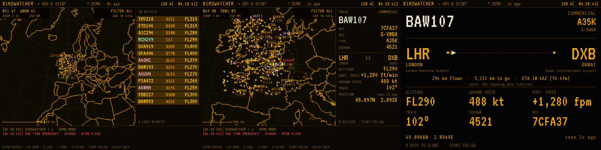

# Birdwatcher

**A cyberdeck-style ADS-B flight tracker for the Anbernic RG35XX SP.**
An amber wireframe globe with live aircraft over WiFi, a full-screen card for any flight with
its route, and an offline database of 620,000 routes. Pure Python, no pygame, nothing to install
on the stock firmware.



## Features

- **Live traffic** from [adsb.lol](https://adsb.lol), falling back to [airplanes.live](https://airplanes.live).
- **Rotating globe** with coastlines and borders (Natural Earth), lat/lon grid, airports, radar sweep
  and CRT scanlines, at a native 640×480.
- **Lock and follow** any aircraft: callsign, hex, registration, type, squawk, altitude, vertical
  speed, ground speed, track and position, with its trail.
- **Full-screen flight card**: origin → destination with airport and city names, km flown and left,
  and an ETA from the current ground speed.
- **Offline routes**: about 620,000 callsigns from the Virtual Radar Server standing data, bundled
  (3 MB). Instant, no network needed; adsb.lol is only asked when a callsign isn't in it.
- **OSINT filters**: military (worldwide `/mil` query), private and business jets, and alerts.
  Emergency squawks (7700 / 7600 / 7500) are polled worldwide and logged in red.
- **Runs on stock firmware**: draws through the system `libSDL2` with `ctypes`; text comes from
  pre-rendered BMP font atlases, so neither pygame nor SDL_ttf is needed.

## Install

1. Download the latest release zip (or clone this repo).
2. Copy the contents of `APPS/` into `Roms/APPS/` on the SD card. `Birdwatcher.sh` and the
   `Birdwatcher/` folder must sit side by side.
3. Turn WiFi on and launch **Birdwatcher** from the apps section.

If a button doesn't respond, run **Birdwatcher - Button setup** and press the buttons in the order
shown; the mapping is saved to `Birdwatcher/config.json`. Errors on launch end up in
`Birdwatcher/log.txt`.

### Extras

`extras/` holds two launchers that aren't needed day to day. Copy them next to `Birdwatcher.sh`
if you want them:

- **Birdwatcher - Diagnostics**: writes `Birdwatcher/diagnostics.txt` with the Python and SDL
  versions, where `libSDL2` lives, the gamepads found and whether both data sources answer.
  Start here if it doesn't run on your device.
- **Birdwatcher - Demo offline**: simulated traffic, no WiFi needed.

## Controls

| Button | Action |
|---|---|
| D-pad | rotate the globe (hold) |
| L / R | zoom out / zoom in |
| A | lock the aircraft nearest the reticle; press again for the next one |
| Y | full-screen card of the locked aircraft (B to go back); with nothing locked, cycles labels |
| B | release the aircraft or stop following it |
| X | filter: all · military · private · alert |
| START | follow the locked aircraft |
| SELECT | help |
| MENU or SELECT + START | quit (saves the view) |

Colours: amber commercial · cyan military · magenta business jet · red squawk 7700 / 7600 / 7500.

Keyboard (for testing on a computer with `--windowed`): arrows, `X` = A, `Z` = B, `S` = X,
`A` = Y, `Q`/`W` = L/R, `Enter` = START, `Shift` = SELECT, `Esc` = quit.

## How it works

- Every 6 s it asks for aircraft within up to 250 NM of the screen centre (`/v2/point`), the API
  maximum. With the whole globe in view you only see aircraft inside the **capture zone** circle,
  which moves as you rotate. Between polls aircraft move by dead reckoning.
- Every ~13 s it queries one emergency squawk worldwide, in turn.
- With the **MILITARY** filter it also queries `/v2/mil` worldwide every 30 s.
- While you rotate or zoom it draws the light 1:110m map; when you stop it redraws the detailed
  1:50m map into a cached layer.
- The flight card checks that the aircraft is actually near the route on file. If it isn't
  (schedules change), it says so and hides the distances.

## Configuration

`APPS/Birdwatcher/config.json`:

| Key | Default | |
|---|---|---|
| `home` | London, zoom 6 | starting view the first time (afterwards the last view is remembered) |
| `poll_seconds` | 6 | seconds between position polls |
| `alerts_seconds` | 40 | full cycle of the three emergency squawk queries |
| `mil_seconds` | 30 | interval for the worldwide military query |
| `scanlines` | true | CRT scanline overlay |
| `fps` | 30 | frame cap |
| `feeds` | adsb.lol, airplanes.live | data sources in order of preference |
| `buttons` | RG35XX SP stock | SDL joystick button numbers (set by Button setup) |

If `libSDL2` lives somewhere unusual, set `BIRDWATCHER_SDL_LIB=/path/to/libSDL2-2.0.so.0` in
`Birdwatcher.sh`.

## Compatibility

Developed and tested on the **Anbernic RG35XX SP with stock firmware**. It should run on other
640×480 Linux handhelds that ship Python 3 and SDL2 (other H700 devices, custom firmwares);
run Diagnostics first and remap the buttons if needed.

## Rebuilding the data

The bundled data can be regenerated with the scripts in `tools/`:

```sh
# coastlines (Natural Earth via world-atlas)
npm pack world-atlas@2.0.2 && tar xzf world-atlas-2.0.2.tgz
python3 tools/build_coastlines.py package/

# offline routes and airports (Virtual Radar Server standing data, CC0)
git clone --depth 1 https://github.com/vradarserver/standing-data
python3 tools/build_routes.py standing-data

# font atlases (needs Pillow; fonts from Google Fonts)
python3 tools/build_fonts.py ShareTechMono-Regular.ttf VT323-Regular.ttf
```

## Data sources and licences

- Live data: [adsb.lol](https://adsb.lol) (ODbL; free for now, an API key is planned) and
  [airplanes.live](https://airplanes.live) (non-commercial use, 1 request per second; Birdwatcher
  keeps to that).
- Routes and airports: [Virtual Radar Server standing data](https://github.com/vradarserver/standing-data), CC0.
- Map: [Natural Earth](https://www.naturalearthdata.com) via [world-atlas](https://github.com/topojson/world-atlas), public domain / ISC.
- Fonts: [Share Tech Mono](https://fonts.google.com/specimen/Share+Tech+Mono) and
  [VT323](https://fonts.google.com/specimen/VT323), SIL Open Font License (see `fonts/`).

Birdwatcher itself is released into the public domain under **CC0 1.0** (see `LICENSE`).

---

by **upanihacks**
